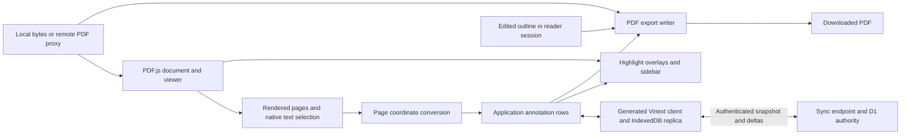

# PDF reader and synchronization architecture

Status: Accepted. Date: 2026-10-18.

This describes the PDF.js reader and the Vinext sync integration. The
[viewer requirements](requirements/pdf-viewer.md) and
[sync requirements](requirements/sync-engine.md) define their behavior; separate
[viewer](pdf-viewer-validation.md) and [sync](sync-engine-validation.md) ledgers
record observed checks. [ADR-0003](adr/0003-vinext-deployment-bootstrap.md)
replaces the old sync/storage boundary with a fresh initial store and D1
snapshot recovery after every deployment.

## Responsibility boundaries

The app composes the PDF.js viewer layer from pinned `pdfjs-dist` **6.4.299**.
`PDFViewer`, `PDFLinkService`, `EventBus` and `PDFFindController` provide page
layout, rendering, text/link layers, destinations and viewer events. The upstream
`TouchManager` is connected following the matching generic viewer application.
The integration retains React controls and sidebars; it does not embed the
unmodified generic viewer HTML or maintain a separate canvas renderer. See
[ADR-0001](adr/0001-pdfjs-viewer.md).

| Boundary | Owns |
| --- | --- |
| [`PDFViewer` React workspace](../components/PDFViewer.tsx) | App controls, current page/scale, selection action and coordination with local rows |
| [Browser viewer controller](../lib/pdfViewerController.ts) | Browser-only startup/cleanup, touch/resize/event subscriptions, selection geometry and app highlight overlays |
| PDF.js viewer/display/worker | PDF parsing, page viewports, rendering queue, text and embedded-annotation layers, internal destinations and upstream touch gesture recognition |
| Application toolbar and sidebars | Page and zoom actions, jump history, annotation editing, outline authoring and visible persistence state |
| [Source helpers](../lib/pdfSource.ts) and `/api/pdf` | Stable source identity, local bytes and existing same-origin remote-fetch boundary |
| [Position helpers](../lib/pdfGeometry.ts) and [row helpers](../utils/pdfSync.ts) | Version-1 position validation and conversion between page, PDF user-space and CSS viewport coordinates |
| [Sync provider](../components/SyncEngineProvider.tsx) and [table adapter](../lib/syncTables.ts) | Authenticated runtime config, complete local collection hydration, UI state, fresh asynchronous row reads and collection mutations |
| Generated Vinext hook and package session registry | IndexedDB replica identity, deployment snapshot bootstrap, leases, account isolation, durable enqueue, deltas and draining cleanup |
| `/api/sync` and [application server hooks](../sync/server.ts) | Authenticated D1 snapshot/delta endpoint, exact-stream and same-origin checks, CRUD policy and canonical authority decisions |
| Opaque auth sessions and D1 | Revocable session-token hashes, stable per-stream materialized records, canonical history and authoritative watermarks |
| [PDF export writer](../lib/pdfExport.ts) (`pdf-lib` 1.17.1) | Standard highlight annotations with note contents and outline updates in a new downloadable PDF |
| [Build asset preparation](../scripts/prepare-pdfjs.mjs) | Matching local worker, rendering resources, viewer CSS and upstream notices |



## Input and document identity

`lib/pdfSource.ts` continues to define `PdfSource`. A remote document key is
derived from the normalized source URL and still opens through
`/api/pdf?url=...`. A local document key is derived from a SHA-256 digest of the
file contents. PDF.js receives a copy of local bytes so worker ownership cannot
detach the source buffer needed for reopening or export.

The viewer does not replace these keys with PDF.js fingerprints, object URLs or
viewer instance IDs. `ensurePdfDocument` resolves the existing document row;
annotations retain their document association across the library change.

Local file bytes remain local input. Synchronized metadata and annotations do
not make that file's contents available to another device.

The existing public page/library flow continues to open URL-backed documents.
Local `PdfSource` bytes are supported and tested at the reader/controller
boundary; this migration does not introduce a local-file picker or another
public document route.

## Viewer interaction and lifecycle

The React workspace creates the viewer after mounting in the browser and
loads the PDF.js modules there. Page/scale events update the app controls. App
navigation delegates to the viewer/link service, while explicit jumps are
tracked for back/forward actions.

The viewer controller is the browser integration boundary. It initializes the
display module before the viewer module, sets the matching local worker URL and
provides methods for navigation, scale, highlights, selection clearing and
source-data retrieval. The app displays embedded annotations; form widgets and
the PDF.js native annotation editor are not app editing stores.

The scroll container supplies native scrolling and panning. The upstream touch
manager supplies pinch recognition, and its callbacks request viewer scaling
around the touch origin. The app does not synthesize double clicks, implement a
second long-press recognizer or draw custom selection handles. The PDF.js text
layer and browser provide selection and handles.

The document effect owns its abort signal, loading task, viewer subscriptions,
resize observer and touch manager. Source changes and unmounting release these
resources and reject obsolete callbacks. Loading errors are rendered in the
workspace. Download object URLs are released after use. These lifetime rules
prevent old documents from updating the active workspace.

## Selection, positions and synchronization

Selection geometry is taken from DOM text ranges in the PDF.js text layer and
converted through each page's viewport. One multi-page selection becomes one
highlight row per selected page. The version-1 shape remains:

```ts
type PdfAnnotationPosition = {
  version: 1
  kind: 'pdf-highlight'
  pageIndex: number
  rect: { origin: { x: number; y: number }; size: { width: number; height: number } }
  segmentRects: Array<{
    origin: { x: number; y: number }
    size: { width: number; height: number }
  }>
}
```

The page index is zero based. Rectangles are measured in unrotated page space
with the origin at the page's top-left, in the existing page units. PDF.js
viewport scaling, page rotation, crop-box offsets and `UserUnit` are accounted
for at the conversion boundary. Neither client coordinates nor zoom factors
are persisted. The same conversion is used when painting overlays and exporting
PDF user-space rectangles/quad points. See
[ADR-0002](adr/0002-portable-annotations.md).

Annotation creation, color/note changes and deletion write through the
application table adapter into generated engine collections. The rendered
highlights are projections of local application
rows. An incoming sync row updates that projection without being interpreted as
a new edit. PDF.js annotation editor storage is not another synchronized store.
Existing embedded PDF annotations may be displayed, but they are not
automatically imported into the app's rows.

Undo/redo is bounded, session-only application history. Before restoring an old
row, the app compares its expected historical content with the current table
row, ignoring only `updated_at`. If an incoming edit or deletion changed that
content, it clears stale history and reports the conflict without writing over
the current row. This protects an observed incoming change; it is not a new
cross-client conditional-write protocol or a persistent undo log.

## Sync schema, sessions and deployment bootstrap

`sync-engine.config.ts` declares stable `appId: "pdf_annotation"`,
`contractVersion: "pdf-annotation/1"`, the `DB` binding and the documents,
annotations and highlight-color collections. Annotation position JSON remains a
string scalar; document source keys and version-1 geometry keep their logical
meaning. The Vinext plugin runs before route discovery and generates the typed
`sync/generated.ts` hook and `/api/sync` composition. `sync/server.ts` owns
authentication and policy. Local core 2.2.0 and Vinext 1.0.0 tarballs under
`vendor/` pin the revised package code.

The initial transition uses fresh sync-managed `se_pdf_annotation_*` tables.
Legacy tables, browser databases and history are retained separately without
adoption. Legacy pull/push and generated CRUD routes return HTTP 410. Existing
users authenticate again with the new opaque session cookie; D1 stores only its
token hash, account and expiration. Snapshot and delta handling share account,
exact-stream and same-origin authorization. Client account IDs, old user-ID
cookies and identity override headers do not establish authorization.

The authenticated session endpoint returns the actual Cloudflare Worker version
ID from `CF_VERSION_METADATA.id`. The provider validates it and passes it as
`deploymentVersion` into a stable client config. Redeploying the same build still
changes the Worker version. Local environments without version metadata fall
back to `__SYNC_DEPLOYMENT_VERSION__`, a build UUID or explicit
`SYNC_DEPLOYMENT_VERSION`; development uses `development`. These IDs are
independent of stable model/storage versions. A registry with the same deployment resumes the existing
replica; a new deployment obtains current account-scoped D1 rows at a canonical
watermark, enables a complete replacement replica and follows later deltas.
D1 remains the authority and is never cleared during browser rebootstrap.

Pending proposals or accepted-awaiting work in a previous deployment block
replacement and remain retained. Snapshot failures likewise preserve the
existing store. A new deployment requires network access for its first
bootstrap. Signout and account changes await local revocation/draining before
changing identity or revoking the server session. A rollback with a different
deployment ID follows the same rules.

The adapter publishes arrays only after all local query pages share a replica
revision. It retries when writes intervene, hides stale account results,
serializes mutations and refreshes arrays before their promises resolve. Fresh
`get()` calls are asynchronous, including undo/redo conflict checks. Inserts,
changed-field updates and deletes enqueue through the engine. Queue counts,
transport/storage/bootstrap failures and persistent authority rejection notices
feed the existing persistence UI. A completed enqueue is local durability;
remote acceptance follows the canonical protocol.

See [ADR-0003](adr/0003-vinext-deployment-bootstrap.md) for alternatives and
tradeoffs, and the [sync verification procedure](sync-engine-validation.md) for
deployment rollover, fault injection and account-isolation acceptance.

## Outline and download

PDF.js reads the original outline and resolves document destinations. The app
keeps the editable outline in reader-session state. Adding, editing or deleting
an entry changes that session; downloading includes those edits in the output
PDF. Outlines are not a new synchronized database collection, and editing does
not rewrite the remote file or original local source.

PDF.js remains the reader. `exportAnnotatedPdf(data, rows, outline?)` loads
original bytes and uses `pdf-lib` to write standard PDF highlight annotations,
colors, note contents and edited outlines into the downloaded document. Omitting
`outline` retains the original tree; an explicit empty tree clears it. Existing
annotations unrelated to exported row IDs are retained; matching annotation
`NM` values are replaced to avoid repeated-export duplicates. No rows and no
outline edit return an unchanged byte copy. Edited output is reserialized by
the writer.

This keeps export independent of PDF.js's editor serialization and preserves
existing app data. Export reports a failure if the writer cannot handle the
source; the UI must not claim that the original PDF was saved merely because
the app has synchronized its rows.

## Build and verification boundary

PDF.js display, viewer, CSS, worker and rendering resources are taken from one
pinned package release and served by the app. The worker is not substituted
with a runtime CDN version. Asset preparation is part of the development and
production workflow; preserve upstream license/notice files when copying assets.
Changing PDF.js versions requires checking its viewer/touch integration as well
as rebuilding assets.

The asset preparation script copies the worker, CMaps, standard fonts, WASM,
ICC profiles, viewer images and license into `public/pdfjs/6.4.299/`. Viewer code
and CSS enter the application bundle from the same package. The versioned public
path is derived from the package version at runtime.

TypeScript, a production build and focused coordinate/export checks establish
integration properties. Browser checks establish actual loading and controls.
Physical iOS Safari and Android Chrome testing establishes gesture usability.
The [evidence ledger](pdf-viewer-validation.md#evidence-ledger) keeps those claims
separate.
